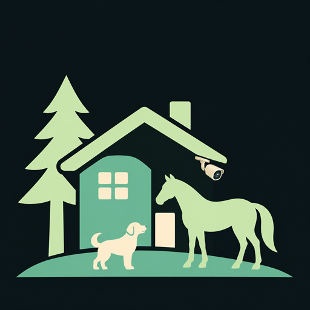

# Property Tracker — native Android TV camera app



Property Tracker is a native Android APK for Android-based Fire TV sticks and NVIDIA Shield. It uses an Android Activity, native TV controls, and Media3 video surfaces. Its original development name was Fieldview; the Android package ID (`com.fieldview.tv`), encrypted-settings alias, and MQTT topic prefix remain stable so existing installations keep their configuration.

[Download TV APK — 0.2.5](https://github.com/lewi3069/property-tracker/releases/tag/v0.2.5) or the [phone APK — 0.2.0](https://github.com/lewi3069/property-tracker/releases/tag/v0.2.0), or build them locally. The native [Pixel/phone app](docs/MOBILE.md) supports direct viewing with touch controls and both orientations. TV and phone builds share the camera core and use separate application IDs.

Version 0.2.5 adds an **opt-in 13-camera TV layout**: one large center camera with 12 around it, plus a default center selection. Enable **Layout → Experimental larger layouts**, then choose 13. This uses native software decoding and existing substreams; ordinary playback limits remain the default. See [implementation, device results and remaining limits](docs/PLAYBACK-025.md).

Development source is 0.2.10, adding [calmer motion switching](docs/MOTION-TIMING-0210.md) to the [adaptive 13-to-8 layout](docs/MOTION-LAYOUT-028.md) and preserving [unsupported-main-stream handling](docs/MAIN-STREAM-COMPATIBILITY-029.md). An [experimental high-resolution center](docs/HIGH-RESOLUTION-CENTER.md) is also available. The downloadable TV release remains 0.2.5. Version 0.2.6 was [installed on five TVs](docs/DEPLOYMENT-026.md). The [memory investigation](docs/MEMORY-INVESTIGATION-2026-11-09.md) confirms continued native-allocation growth and a subsequent SIGKILL; the trigger for that kill remains unproven. The [overnight review](docs/OVERNIGHT-REVIEW-2026-11-09.md) records the earlier host improvements and observations.

A later [native output experiment](docs/NATIVE-OUTPUT-TRIAL.md) identified retained Fire OS frame-timing allocations. Its debug-only SurfaceView prototype is **disabled by default** and restricted to the tested TV profile; layout/compositor limits and multi-hour stability still need validation. No experimental APK is published.

Version 0.2.4 opens the TV app directly into the selected fullscreen camera layout. Press **Back** to reveal the controls. Empty-camera setup keeps its controls visible, and phone startup keeps its existing behavior.

Version 0.2.3 stages camera startup and reconnects through a two-attempt queue, adds retry jitter and per-camera diagnostics, and keeps detection heartbeats from changing motion priority. **Layout → Experimental grid compatibility** enables an opt-in TextureView grid; single-camera and floating playback retain SurfaceView. The experiment defaults off and retains existing device limits. See [implementation and validation limits](docs/PLAYBACK-023.md).

Version 0.2.2 limits AFTKM Fire TV sticks to four simultaneous cameras after a reported vendor graphics-service crash on a device configured for nine. Existing saved and remote requests are clamped before players start; every saved camera remains available through View. This is a mitigation, with [incident evidence and validation limits](docs/INCIDENT-2026-11-08.md).

The [playback improvement plan](docs/PLAYBACK-IMPROVEMENT-PLAN.md) records the review and remaining matched tinyCam comparison, renderer trials, transport work, and tests required before enabling larger layouts on the affected model. Four cameras is a temporary app compatibility policy, not a measured hardware maximum.

**Playback compatibility:** earlier HEVC floating-camera/Plex sessions froze on an AFTMM Fire TV Stick. Version 0.1.12 adds stall recovery and an optional software H.264 compatibility mode. One 45-minute comparison with a 640 × 480 software-decoded H.264 camera and hardware-H.264 Plex completed successfully. See [the test results and limits](docs/testing.md#later-freeze-and-0112-compatibility-trial).

Version 0.1.14 supplies PNG launcher icons and a matching TV banner at five densities, with explicit launcher-activity artwork. On the tested Fire TV, cached Home and app-grid thumbnails also needed a launcher-registration refresh; see [the icon validation and refresh notes](docs/testing.md#version-0114-fire-tv-icon-compatibility). [Artwork and regeneration instructions](assets/branding/README.md). Playback logic is unchanged from 0.1.12.

Version 0.1.15 removes camera-name bars in every view and adds **Layout → Full screen layout → Save**. The selected multi-camera layout fills the display with the app controls hidden. Remote focus remains visible; select a camera to enlarge it, then press Back to return to the same Auto/Grid layout. Back again restores the controls. This full-screen choice lasts for the current viewing session.

Version 0.1.18 adopts option B: a small camera on the house with a pine tree, dog, and horse, plus a rectangular TV tile. It also supports Android 5.1/API 22: older AFTT sticks use a two-camera budget and encrypted settings protected by a Keystore RSA-wrapped AES key. Newer installations retain their existing AES Keystore identity. Fire TV Home can still show stale or missing artwork on existing installations; the updated PNG resources and explicit launcher metadata do not yet establish a Home-cache fix. See [validation and limits](docs/testing.md#version-0118-older-fire-tv-support-and-artwork).

Version 0.1.19 lets Home Assistant control an existing floating view: the selected camera is its default, motion temporarily switches cameras, and no motion restores the default. It preserves the silent single-grid-stream window and software H.264 compatibility preference.

## Build and install

Use JDK 21 and Android SDK 35/36 for the full build and test suite. TV retains its older-device support; the phone Play candidate targets Android 16. The task-local Windows toolchain is:

```powershell
.\scripts\bootstrap-android.ps1
.\scripts\build-android.ps1
```

The bootstrap downloads official build tools into the ignored `.tools` directory and accepts their Android SDK build-tool licenses. JDK and Gradle archives are checksum-verified. No system-wide tool installation is needed. Build caches, debug signing key, and SDK stay in the project.

The [Android checks workflow](.github/workflows/android.yml) tests, builds and lints both targets on source changes and pull requests. It also checks PowerShell syntax, diagnostic summaries, package identities, SDK levels and native-library separation. CI uses a disposable debug signing key and saves test/lint reports; it does not publish installable APKs or access camera settings. The first full [Linux verification run passed](https://github.com/lewi3069/property-tracker/actions/runs/42580463373).

Google Play preparation is documented in [the submission notes](store/play/submission-notes.md). The signed 0.2.1 Play candidate uses `com.lewi3069.propertytracker`; the historical debug phone ID is already occupied by another app on Google Play. Play Console setup and distribution choices are still pending. The downloadable phone APK remains 0.2.0; the TV release is 0.2.5.

The build creates `app/build/outputs/apk/debug/app-debug.apk` for TV and `mobile/build/outputs/apk/debug/mobile-debug.apk` for phones. A TV copy for installation is provided as `dist/property-tracker-0.2.5-debug.apk` after verification. This is a development APK signed with the same local debug key as earlier versions, so it can update the existing installation without clearing saved settings. A fresh bootstrap creates a new local signing key; updating an existing installation requires its original signing key or a matching signed release APK.

Once ADB is paired with the target device:

```powershell
adb -s DEVICE_ADDRESS:5555 install -r .\dist\property-tracker-0.2.5-debug.apk
adb -s DEVICE_ADDRESS:5555 shell am start -n com.fieldview.tv/.MainActivity
```

Use the device's normal developer/ADB pairing flow. The app supports Android 5.1/API 22 or later, including the older AFTT Fire TV Stick with a two-feed limit. Vega OS devices cannot run this Android APK.

## Native controls

- **Cameras:** the numbered list is the saved default viewing order. Choose an existing camera for **Edit camera**, **Copy camera**, **Move up**, or **Move down**. The move actions save immediately and return to the list at the moved camera; the new order controls the default grid after restart. Each device saves its own order.
- **Copy camera:** opens an unsaved draft prefilled with the source's address, port, login, zone, and stream paths. It starts with a unique name and camera ID. Change the address/name as needed and choose **Save camera** to add it. **Cancel** leaves the source and catalog unchanged; the existing camera is never overwritten by a copy.
- **Enable/disable:** select a camera under Cameras and choose **Disable camera** or **Enable camera**. The Edit camera form also has an **Enabled for live viewing** checkbox. Disabled entries keep their connection details and saved position, and are marked `(disabled)` in the catalog. They are excluded from the grid, fullscreen picker, and automatic activity/location selection. The setting persists on this installation, and copies retain the source's enabled state. Existing cameras remain enabled after upgrading.
- **Add/edit:** enter the camera's local IP/hostname, RTSP port, login, and grid/main paths. Reolink and Amcrest presets fill common paths; paths remain editable for NVR channels and model differences. **Save camera** and **Cancel** stay in a fixed action bar below the scrolling fields. From the final field, remote Down or the keyboard's Done moves focus to Save camera. The app starts with no cameras or credentials configured.
- **Layout:** choose the visible count and whether enlarged views use the main stream. **Prefer software H.264 for floating video** is an optional compatibility setting, off by default. It prefers a software decoder only for floating H.264, with hardware fallback if initialization is unsupported. Use a small H.264 grid stream; software decoding uses more CPU. H.265 and ordinary viewing retain normal decoder selection. AFTMM and AFTKM Fire TV sticks and Android devices reporting low RAM offer 1, 2, or 4 feeds; their saved and remote layout requests are limited to four before players start. Other devices retain the 1/2/4/6/9 choices, whose sustained capacity still needs testing. All saved cameras remain accessible through View regardless of the simultaneous-feed limit.
- **Full screen layout:** in Layout, enable this checkbox and Save to fill the display with the selected 1/2/4/6/9 layout, within the device's existing feed limit. The toolbar, footer, outer margins, and Live badges are hidden. Multi-camera layouts retain a thin remote-focus border, and all videos preserve their aspect ratios. Menu reopens Layout; Back restores controls. Entering/exiting full-screen layout reuses unchanged streams and does not promote them to main-stream quality.
- **View:** select any configured camera, including one outside the current grid, for fullscreen viewing. Single-camera fullscreen hides the app toolbar, footer, Live badge, and tile borders, and uses the full display while preserving the video's aspect ratio. Camera-name bars are absent in all views; camera names remain in the pickers and accessibility labels. Connection/error messages remain available when a stream is not playing.
- **Float:** select one enabled camera to keep its silent grid stream in a small bottom-right window over other apps. In fullscreen, Menu → **Float camera** starts the current camera. Property Tracker releases its regular wall players before starting the floating stream. The floating window does not take remote focus, so the other app keeps its controls. The floating window omits the camera-name bar. Return to Property Tracker to close it, or use **Close camera** in its ongoing notification. Screen-off and task removal also stop the session. Android can restore an active session after process termination, using the same camera's current saved settings. Returning to the viewer cancels a pending restart. A restored session rechecks permission, camera enabled state, and whether the TV is awake. It does not start at boot.
- **Auto:** activity takes priority over a stable horse location, then the ordinary overview. Up to two cameras can be enlarged, within the chosen tile limit. A one-camera layout stays at one camera.
- **Grid:** keep the overview fixed while incoming events continue to be tracked.
- **Remote OK:** pin the focused camera fullscreen. When a single camera is pinned, **Down** selects the next enabled camera and **Up** selects the previous one in saved order, wrapping at either end. This browses all enabled cameras, including those outside the grid's tile count. Each press changes one camera; holding a direction does not repeatedly restart streams. In a multi-camera full-screen layout, arrows navigate the tiles normally. **Back** from a pinned camera returns to the previous Auto/Grid mode, preserving full-screen layout if active. Back from a full-screen layout restores the toolbar and footer; Back from the ordinary unpinned viewer exits. **Menu** opens layout settings, where arrows retain normal menu navigation.
- **Home Assistant:** configure the optional MQTT connection and site/screen IDs. No Home Assistant API token is required.

Only visible cameras have player instances. Unchanged players are reused while tiles move. Hidden feeds and wall playback resources are released when leaving the app; an explicitly started floating view instead keeps just its one grid stream in a foreground service. Load-control allocation targets are 2 MiB per grid player and 8 MiB per enlarged player. They prioritize byte thresholds over time buffering, but do not cap all RTSP packet queues or native decoder/graphics memory; see [the code review](docs/CODE-REVIEW-2026-11-03.md). A released player is marked inactive before detaching it so callbacks cannot release it again. Each failed feed retries independently with a backoff up to 30 seconds. Audio is disabled. RTSP uses TCP transport. The initial TCP connection has a five-second deadline, and a twenty-second playback watchdog monitors startup and continuing frame submission, including streams that remain READY. Retry history resets after ten seconds of sustained progress. After three unrecovered frame stalls, the tile stops retrying and asks you to reopen it. These checks cannot repair a wedged system codec or compositor. A tile is marked Live only after the first video frame renders. Connection, login, and path failures show fixed explanatory text without exposing credential-bearing errors.

Floating view requires Android's **display over other apps** permission. Some Fire TVs resolve the standard permission screen to a nonfunctional placeholder. On devices where the permission screen is unavailable, an authorized ADB connection can grant permission specifically to this application using `adb shell appops set com.fieldview.tv SYSTEM_ALERT_WINDOW allow`. It can be revoked with the corresponding `deny` operation. This is a custom overlay, separate from native Fire OS picture-in-picture. The service is not exported and receives only a camera ID; credentials are loaded from encrypted app-private settings, not passed through intents or notifications.

Version 0.1.9 uses SurfaceView for floating playback, matching the normal viewer. The earlier TextureView window displayed green on a Fire TV Stick 4K (AFTMM); after the change, the user confirmed normal floating video. ADB video captures can still be misleading on this device, so first-frame callbacks or screenshots alone are not sufficient visual validation.

Version 0.1.10 adds recovery after Android terminates the floating process, and lifecycle logs distinguish explicit stops from unexpected process loss. Android controls when resources are available for a restart, so recovery can include a visible interruption. This follows Android's [service restart behavior](https://developer.android.com/develop/background-work/services#ExtendingService).

See [test results and scope](docs/testing.md) for the completed Plex comparison and the remaining hardware/recovery checks. The read-only monitor performs no app control or deliberate process termination.

H.264 and H.265/HEVC RTSP streams are supported when their codec profile, resolution, and frame rate fit the device's decoder. Supported 3840 × 2160 HEVC feeds rendered on a Fire TV Stick 4K (AFTMM). Several wider/taller camera main streams exceeded that Firestick's advertised dimensions; those entries use lower-resolution streams for fullscreen. This is separate from bandwidth-related buffering. Native setup stores camera/broker credentials encrypted with an Android Keystore key in app-private storage, with Android backup disabled. Stream addresses and command payloads are not logged by the app; Media3 logging is disabled.

## Home Assistant control

Commands go to `fieldview/<site>/<screen>/command` on the configured broker. They affect the open main viewer or an already running floating session; they do not wake the TV or start a floating window. See [the native MQTT contract and Home Assistant examples](docs/native-mqtt.md).

Activity messages expire, are deduplicated, and cannot replay from retained MQTT messages. Horse locations need five seconds of stability and expire after a minute without a fresh observation. Temporary layout commands expire back to the screen's saved count. Manual fullscreen pinning takes precedence over automatic activity/location events.

Configure cameras privately on each installation. Home Assistant MQTT delivery and automatic expiry back to the saved layout were verified on an AFTMM installation on November 5, 2026. Version 0.1.19 adds MQTT control to the floating service. Its selected camera is the session default. Motion temporarily switches the stream, then motion-clear or expiry restores the default. Heartbeats keep an active camera playing without recreating its player; competing motion waits until the current activity clears. Home Assistant can also select a new default or close the active window. Location and layout commands remain main-viewer controls. See the command reference for motion-on, motion-clear, and periodic refresh rules.

## Validation and current limits

```powershell
.\scripts\build-android.ps1
```

This runs JVM tests for catalog copying/order persistence, the native view selector/command router, connection/error handling, and Robolectric UI regression tests for form visibility, keyboard resizing, and Save-button focus, builds the APK, and runs Android lint. APK signature and package metadata are checked separately with the SDK tools. Playback, native remote navigation, camera copy/reordering/enabled state, Home Assistant MQTT layout commands, and a 45-minute software-H.264 floating-camera/hardware-H.264 Plex comparison have been exercised on an AFTMM device. See [validation details](docs/testing.md). Other hardware, decoder capacity, activity/location automations, and longer sustained operation still need testing.

The earlier browser layout experiment is preserved under `design-reference/browser-prototype`. It is not packaged into the Android app and is no longer the project entry point. The native implementation is under `app/src/main`.

Version 0.2.0 adds the native phone target and improves MQTT subscription/retry handling, bounds pending UI commands, reuses unaffected players during catalog edits, and lowers the main-view polling rate. See [the current reliability review and remaining risks](docs/CODE-REVIEW-2026-11-06.md).
