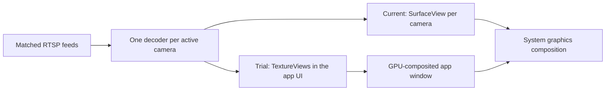

# Playback review and improvement plan

Reviewed November 8, 2026, against TV 0.2.2 / commit `06f780d`. This is a source review and implementation plan; it introduces no runtime change or live-device experiment.

Implementation has since begun in **0.2.3**: shared startup/retry admission, diagnostic events, stream-profile buffer selection, stable motion heartbeat priority, preservation of requested layouts, and an opt-in grid renderer. [Current implementation, validation and remaining work](PLAYBACK-023.md). Findings below describe the reviewed 0.2.2 baseline, not the later implementation.

The goal is reliable six-camera and then nine-camera viewing on the affected Fire TV, using a workload comparable to the owner's working tinyCam setup. The current four-camera safeguard is an app compatibility policy, not a measured hardware maximum. Its removal depends on evidence for the replacement playback path.

## Evidence and unknowns

The [incident review](INCIDENT-2026-11-08.md) establishes a vendor graphics-composer crash followed by an Android runtime restart, 14 successful individual H.264 grid-stream checks, and a five-minute four-camera run with advancing surfaces and stable app/system processes. A separate trial displayed two larger H.264 feeds and returned to the overview after expiring activity messages. These checks do not establish nine-camera capacity or explain the vendor crash's exact trigger.

The owner reports that tinyCam Pro displays more cameras successfully. Its installed version, decoder mode, actual protocols, selected streams, resolution, frame rate, bitrate, and sustained workload have not yet been matched against Property Tracker. tinyCam documents selectable decoder modes and automatic main/substream profiles; this does not reveal which implementation or settings were active on the owner's TV. See its [video settings](https://www.tinycammonitor.com/manual/app_video.html) and [stream-profile changelog](https://tinycammonitor.com/changelog.html).

## Review findings

| Priority | Finding | Evidence and implication |
| --- | --- | --- |
| High | The grid gives every camera a separate video surface. | [CameraTile](../app/src/main/java/com/fieldview/tv/CameraTile.java#L63) constructs a default Media3 PlayerView per tile. Separate SurfaceView layers are a plausible pressure point for the observed composer failure. This is a hypothesis, not an established cause. |
| High | Player startup and retries have no shared admission control. | [MainActivity.render](../app/src/main/java/com/fieldview/tv/MainActivity.java#L353) starts every requested tile in one pass. [CameraTile.scheduleRetry](../app/src/main/java/com/fieldview/tv/CameraTile.java#L218) gives each player the same retry sequence without jitter. Startup, network recovery and camera replacement can create bursts of decoder/graphics allocation. |
| High | The configured buffer targets do not bound total playback memory. | [CameraTile](../app/src/main/java/com/fieldview/tv/CameraTile.java#L135) sets 2/8 MiB allocator targets, but the pinned Media3 1.6.1 TCP RTP channel uses a LinkedBlockingQueue constructed without a practical packet cap. Its bytecode was checked against the resolved dependency. Native decoder and graphics buffers are also outside those targets. This remains a risk, not a demonstrated cause of the recent crash. |
| High | Current logs cannot reliably identify the failing camera or distinguish failure stages. | [Playback callbacks](../app/src/main/java/com/fieldview/tv/CameraTile.java#L142) log decoder and error information without a camera identifier. Periodic health logging is enabled for Float, not the wall. [PlaybackFailure](../app/src/main/java/com/fieldview/tv/PlaybackFailure.java) often maps decoder errors to a generic stream/settings message. |
| Medium | Buffer policy follows presentation emphasis rather than the actual stream. | The allocator target is selected from `featured` only when the player is constructed. A featured substream can receive the larger budget, and changing emphasis without changing URI does not retune an existing target. |
| Medium | The playback budget lacks workload and renderer information. | [PlaybackLimits](../app/src/main/java/com/fieldview/tv/PlaybackLimits.java) considers model/low-RAM status. It cannot distinguish nine small AVC streams from nine larger or HEVC streams, or a verified compatibility renderer from the current path. |
| Medium | A safeguard overwrites the requested layout. | [Startup clamping](../app/src/main/java/com/fieldview/tv/MainActivity.java#L102) persists the effective limit as the saved preference. Future work should distinguish a requested layout from the currently validated count, and describe the restriction as an app compatibility limit. |

Existing strengths should remain: hidden players are released before replacements, unchanged URIs reuse players, main-stream demotions precede promotions, audio is disabled for camera playback, the watchdog continues after READY, and MQTT processing is bounded and lifecycle-owned. Rewriting those working pieces is not the first performance task. UI lookup costs and the one-second selection tick are lower priorities than native video work.

## Recommended sequence

### 1. Establish a matched baseline and useful diagnostics

Create a sanitized comparison record for tinyCam and Property Tracker on the same TV. Match the active camera set, layout, protocol, main/substream choice, codec, resolution, frame rate, bitrate and aspect-ratio behavior. Record the decoder name, rendering mode when observable, cold-start time, delivered/rendered frame rates, memory and live delay. Run the apps sequentially so simultaneous camera connections do not distort the comparison. Keep camera credentials and complete stream URLs out of records and screenshots shared publicly.

Add a playback session ID and safe camera identifier to every start, retry, decoder, first-frame, stop and failure event. Classify connection/authentication/path, decoder initialization/resource exhaustion, stream parsing, and lack of video progress separately. Use fixed classifications and approved numeric/codec fields; avoid raw exception text that can contain credentials. Collect low-frequency wall diagnostics as well as Float diagnostics.

Track decoder output, frame submission and presentation as different signals. Metadata callbacks and an initial Live badge are insufficient evidence of continued visible motion. A TextureView trial will also need different presentation telemetry: counting one SurfaceFlinger layer per camera is not a valid test for a grid composited into the app window. Physical-TV confirmation remains part of validation.

Deliverable: one repeatable comparison procedure and a diagnostic record that identifies which tile failed and at which stage. This phase can begin with host-side code and controlled test sources; it does not require lifting the production cap.

### 2. Smooth startup, recovery and transitions

Introduce a viewer-owned playback coordinator that limits concurrent startup attempts. Begin with two in-flight starts as an experiment, and release a permit on first frame, failure, cancellation or an admission deadline. Queued tiles should not begin their connection/stall timers before they are admitted. All player calls must respect the player's application thread.

A startup deadline must cancel and release its attempt before another attempt takes the slot. Late callbacks must not revive a cancelled player or free a newer session's permit. This ownership rule is part of the coordinator's regression tests.

Prioritize the selected/featured camera, then visible grid tiles. Cancel obsolete queued work immediately on layout changes, leaving the viewer, Float handover, disable/remove, or camera selection changes. Keep the existing release-before-replace behavior. Measure surfaces and decoder allocations during transitions; returning from player release is not itself proof that every native graphics allocation has disappeared.

Add bounded retry jitter and route retries through the same coordinator. A camera with a bad password or an unreachable endpoint must not repeatedly disrupt working feeds. Decoder resource failures should cause a deferred or reduced playback plan with a useful status, rather than an immediate allocation burst. Keep reconnecting individual unavailable cameras without restarting the entire wall.

Choose the buffer target from an explicit stream profile (grid substream versus enlarged main stream). A larger tile using the same substream should not automatically need the main-stream buffer budget. Test that profile changes do not restart unchanged streams unnecessarily.

Meaningful tests cover cancellation races, released tiles staying stopped, bounded in-flight starts, retry bursts, unchanged-player reuse, and main/grid/Float transitions. These are functional improvements to evaluate independently from renderer changes.

### 3. Compare rendering paths with decoding held constant

The first renderer experiment should be a TextureView grid using the same Media3 version, hardware decoder policy, H.264 sources and quality as the current SurfaceView grid. Change only the presentation path so a result can be attributed to it.

Android explains that SurfaceView contributes separate composition layers, while TextureView content is drawn through the app's GPU-rendered view hierarchy. SurfaceView also has important efficiency and full-resolution TV benefits, so TextureView is a candidate to measure, not an assumed universal improvement. See [AOSP's rendering comparison](https://source.android.com/docs/core/graphics/arch-tv) and [Media3 surface guidance](https://developer.android.com/media/media3/ui/surface).

The paths above are alternatives tested one at a time. TextureViews do not eliminate per-camera decoding or guarantee lower memory use.

Use an opt-in trial build/configuration, with the production safeguard retained. In Media3 1.6.1, choose the PlayerView surface type at creation through a layout/factory; do not plan around a nonexistent public runtime surface-type setter. Keep the existing Float SurfaceView and its software-H.264 preference independent. That avoids repeating the earlier green floating-video issue while evaluating a wall-specific change.

Start at two and four streams. Proceed to six and nine only in the controlled trial after the lower counts pass. Include grid/fullscreen browsing and main-view/Float transitions; define how a verified grid renderer hands off to a full-resolution single-camera renderer before shipping. A dense-grid experiment must not silently reduce fullscreen quality.

If the rendering comparison does not resolve the problem, run a separate H.264 software-decoder comparison with the rendering path held constant. Platform software codecs and tinyCam's software implementation are not assumed equivalent. If profiling then points to composition overhead, evaluate one shared OpenGL grid as a later option. A shared compositor still needs multiple stream decoders and introduces additional lifecycle, pacing and aspect-ratio work.

### 4. Replace blanket limits with validated playback profiles

Use the actual stream dimensions, frame rate, codec, decoder, renderer, memory observations and demonstrated device results to choose a safe effective plan. A small display tile does not shrink the encoded stream. At the same frame rate, a 1024 × 1024 source has about 4.6 times the pixels per frame of a 640 × 360 source.

Codec capability APIs are input to the plan, not proof of simultaneous capacity. Android describes `getMaxSupportedInstances()` as an upper-bound hint whose achievable concurrency depends on resources. Guard API 23+ queries on older sticks, and use size/rate support information where available. See [instance capabilities](https://developer.android.com/reference/android/media/MediaCodecInfo.CodecCapabilities#getMaxSupportedInstances()) and [video capabilities](https://developer.android.com/reference/android/media/MediaCodecInfo.VideoCapabilities#areSizeAndRateSupported(int,%20int,%20double)).

Store requested layout separately from effective layout, using a backward-compatible migration. Existing installations currently saved at four must not be silently changed to nine. Preserve camera order, enabled states, MQTT identity and credentials. The normal UI should explain the current app compatibility limit; detailed renderer/codec information belongs in diagnostics.

Use existing substreams for the grid and promote only selected cameras when their main format fits the playback plan. Do not silently alter camera encoder settings or claim that skipping displayed frames reduces the incoming decode workload. Any quality tradeoff must be explicit and measured against the matched baseline.

### 5. Address transport memory and dependency maintenance separately

Verify queued RTP bytes and native memory under an intentionally slow consumer using a controlled source. The current public RtspMediaSource factory exposes no packet-queue limit, so lowering the load-control target is not a complete solution. Evaluate a maintained upstream change or a narrowly scoped transport/library patch if the queue remains unbounded in the chosen version. Arbitrarily discarding compressed RTP packets, or blocking a shared RTSP/control reader without examining its behavior, is not a safe buffering strategy. Recovery must return to a decodable stream and affect only the failing session.

The official release page currently lists Media3 1.11.1 as stable. A dependency upgrade is a separate experiment: Media3 1.9 raised the minimum Android API to 23, while this app supports API 22. Preserve an older-stick build path or explicitly design modern and legacy variants/adapters before upgrading shared dependencies. Check the candidate's actual AAR/SDK requirements and relevant fixes; do not assume that newer Media3 repairs the vendor composer or bounds RTP memory. [Official release notes](https://developer.android.com/jetpack/androidx/releases/media3).

Keep transport, library, renderer and camera-encoding changes separate while establishing cause and effect. A larger video engine/native decoder rewrite is a fallback option after profiling, not the first change.

## Validation and promotion criteria

| Test | Required evidence before promoting a larger layout |
| --- | --- |
| Matched workload | Same actual camera streams, quality and protocol as the tinyCam comparison; every displayed tile actively updating. |
| Progressive counts | Trial two/four first, then six/nine. Stop at the first new graphics/runtime restart, unrecovered tile or decoder-allocation failure. |
| Soak | Proposed gates: ten minutes at each initial count, then one hour and an overnight run at the target count. These are future tests, not completed results. |
| Camera visibility | No persistently blank, green or frozen feeds; physical-TV confirmation plus appropriate per-renderer counters. |
| Performance | Record per-camera FPS and live delay against the matched baseline. Do not meet a count target by silently reducing quality or hiding failed tiles. |
| Resource stability | App/native memory should settle after warmup; inspect trends and recovery after repeated transitions. No unexplained app, codec, composer, SurfaceFlinger or system-server restart. |
| Transitions | Repeated grid/pin/grid, remote up/down, activity on/clear/expiry, camera edits and main/Float handover; no leaked sessions or excess retained surfaces. |
| Failure recovery | Controlled-source disconnect, invalid login and slow consumer; working feeds remain live and the affected feed recovers independently. No production firewall or camera-encoder changes for fault injection. |
| Compatibility | AFTKM target; AFTMM and AFTT retain their established safeguards; Shield capacity is measured independently. Phone orientation/fullscreen and Float/Plex regressions remain separate checks. |

The first implementation should deliver diagnostics and staged startup, followed by the isolated TextureView comparison. Lift the default AFTKM limit only for a profile that passes the agreed workload and stability tests. If the candidate fails, retain the tested profile and use its measurements to choose the next experiment.

## Scope of this review

No TV installation, navigation, camera encoding, Home Assistant automation, broker configuration or camera credential changed during this review. No new live playback or host regression result is claimed. The existing 0.2.2 mitigation remains the installed behavior; the stages above are proposed work.

## Subsequent implementation

Version 0.2.3 delivered staged startup and renderer diagnostics; 0.2.4 added fullscreen startup. The [0.2.5 trial](PLAYBACK-025.md) records the next hardware/platform-software failures and opt-in native backend. The longer soak, matched tinyCam workload, latency, fault recovery and transport-backlog gates above remain outstanding. The review-scope statement above describes the original review, not later authorized device work.
